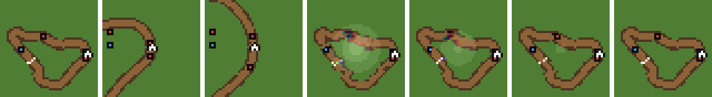
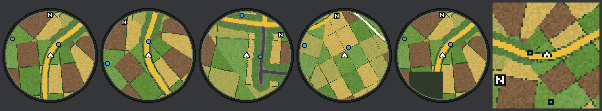

# MiniMap for Half Grip

**Version 1.2.4** · for Half Grip Demo 0.418 · needs [HalfGripTools](https://github.com/4l3x4nd3r0/HalfGripTools) 1.0.2 or newer

A pixel-art map of the whole lap that turns with your car and shows every racer. Buy a **GPS** for your dash, or switch on the
**screen minimap**. It works on every map: the game's own, [ProcTrack](https://github.com/htubdawg/ProcTrack)'s procedural maps, and
other modded maps. In the [Open World](https://github.com/htubdawg/HalfGripOpenWorld) mod's free roam it shows the country round your
car instead.

*100% AI generated code.*


## The GPS

A **$25** item in the shop. It stands on the dash in one of the two module slots, the same slots as the nitro lever, the magnet and
the slow-mo buttons. Its screen shows the map: the whole lap turned so the way your car points is up, your car as a white arrow, bots
as red dots and other players as blue dots. It has no other effect, so it costs you a module slot and a little money.

You can poke its screen with the cockpit hand, like the screen in the main menu: the picture bulges, tears and lights up where you
tap, with the menu's tap sound. A **left click** only taps it. A **right click** taps it and zooms through three views in turn:
middle, out, in, then middle again. In a race the GPS starts zoomed out, on the whole lap; the middle view is twice that size and
in is four times, both with your car in the middle (other cars out of sight wait at the rim). In the Open World it starts in the
middle, `OpenWorld.ViewTiles` across; out is twice that and in is half. Races and the Open World each keep their own zoom until you
quit the game. The screen minimap does not zoom.



## The screen minimap

The same map in a corner of the screen (top left, clear of the placement board). It is **off by default**. To use it, set
`Display.Enabled = true` in the config and restart the game. It then shows in every race, and **K** hides or shows it.


## In the Open World

The [Open World](https://github.com/htubdawg/HalfGripOpenWorld) mod (0.4.6 or newer) is free roam with no lap, so there both maps show
the country round your car: you in the middle, the way you point up, about 625 m across (`OpenWorld.ViewTiles`). The colours are the
Open World's own map: fields, woods and towns, rivers and lakes in blue, and the roads by class (trunk road orange, main roads yellow,
minor roads cream, streets grey, lanes white, farm tracks brown). Roads stay unbroken however small the map. A white **N** at the
rim points north. Other players are blue dots; one out of sight waits at the rim, in the direction to drive to find them. Ground not
loaded yet is dark. Without the Open World mod nothing changes.



## Colours

The map is coloured to match where you are racing:

| Map | Ground | Road |
|---|---|---|
| Stadium | dirt | grey asphalt, concrete edges |
| Forest | green grass (rust red in the red forest) | brown dirt |
| Mountain | white snow | grey |
| Factory | ochre dirt | dark, hazard orange edges |
| Tokyo | dark city | dark, neon pink edges |

The weather shades it too: night darkens it, and snow and ash cover the ground. A modded map with a scene of its own gets colours
read from its own ground and road.

## Install

1. Install [HalfGripTools](https://github.com/4l3x4nd3r0/HalfGripTools) (1.0.2 or newer) if you have not already.
2. Download this repository (**Code > Download ZIP**) and open the zip.
3. Copy the **`MiniMap`** folder out of it into `<game>\BepInEx\HalfGripMods\`.
4. Start the game. The mod manager in the main menu should list **MiniMap**.

> [!IMPORTANT]
> **Copy only the `MiniMap` folder, not the whole download.** The zip unpacks to `HalfGripMiniMap-main\`, and the mod is the
> `MiniMap` folder inside it. `mod.json` must sit **directly** inside `HalfGripMods\MiniMap\`, or the mod does not load.

Right:

```
Half Grip Demo\
└── BepInEx\
    └── HalfGripMods\
        └── MiniMap\
            ├── icon.png
            ├── mod.json
            └── src\
```

Wrong (one folder too deep, the mod does not load):

```
Half Grip Demo\
└── BepInEx\
    └── HalfGripMods\
        └── HalfGripMiniMap-main\      <- the whole download
            └── MiniMap\
                └── mod.json
```

`<game>` is the game's folder, usually `C:\Program Files (x86)\Steam\steamapps\common\Half Grip Demo`. If the mod does not show up,
look for `Loaded MiniMap` in `BepInEx\LogOutput.log`.

## Keys

| Key | Does |
|---|---|
| **K** | Show / hide the screen minimap. The key is only there (in Settings > Controls, where you can rebind it) when `Display.Enabled` is on. |
| **Left click** on the GPS | Tap its screen |
| **Right click** on the GPS | Tap its screen and zoom: middle, out, in, back to middle (races start out, the Open World in the middle) |

## Settings

In `BepInEx\config\halfgrip.minimap.cfg`, written the first time the game runs with the mod. The file is read again whenever it is
saved, so you can change these while the game runs (all but `Display.Enabled`, which needs a restart).

| Setting | Default | What it does |
|---|---|---|
| `Display.Enabled` | `false` | Use the screen minimap and add its K key to Settings > Controls (restart after changing it) |
| `Display.Corner` | `TopLeft` | `TopLeft`, `TopRight`, `BottomLeft` or `BottomRight` |
| `Display.Size` | `300` | Width, in pixels of a 1080 pixel high screen |
| `Display.PixelSize` | `3` | Screen pixels per map pixel (3 matches the game's art) |
| `Display.Margin` | `24` | Gap to the edges of the screen |
| `Display.Opacity` | `0.9` | 1 is solid |
| `GPS.Width` | `1.9` | Width of the GPS on the dash, in dash units |
| `GPS.OffsetX`, `GPS.OffsetY` | `0`, `-0.6` | Move the GPS on the dash |
| `GPS.LitCasing` | `true` | Light the GPS casing like the cockpit (turn it off if the casing does not show) |
| `OpenWorld.ViewTiles` | `2.5` | In the Open World: how much country both maps show across, in its 250 m tiles (1 to 8); the GPS's middle view |
| `Debug.VerboseLog` | `false` | Write each map build to the log |

## Notes

- The GPS is saved in your run under the id `minimap.gps`. If you remove the mod, a saved run loses the GPS (the game does this for any
  removed mod's items) and nothing else.
- In speedrun mode HalfGripTools does not load mods, so there is no GPS and no minimap.
