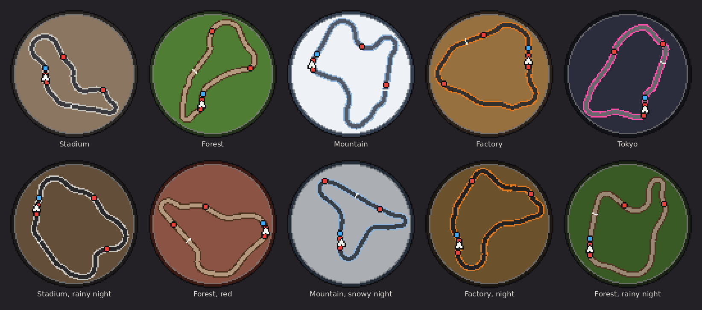
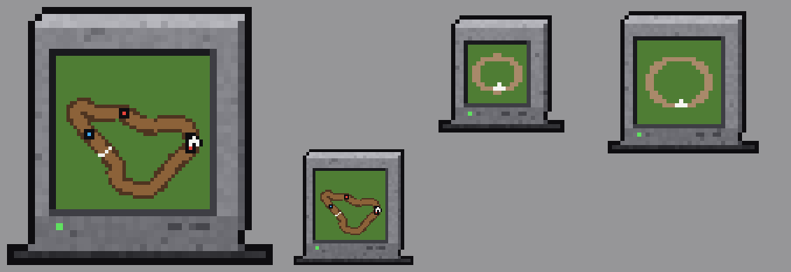

# HalfGripMiniMap
Minimap for half grip demo
100% AI generated code

============================================================
MINIMAP  (MiniMap 0.3.2, for Half Grip Demo 0.418)
============================================================

A round, pixel-art minimap in the top left corner of the screen during races,
clear of the placement board.

  - Shows the whole lap, turned so the way your car points is always up.
  - Your car is the white arrow; bots are red dots, other players in a
    Multiplayer room are blue dots. The chequered bar is the start line.
  - Works on any map: it is drawn from the race's own track line, so the
    game's maps, ProcTrack's procedural maps and other modded maps all get
    one. If a mod replaces the track after the scene loads, the map redraws.
  - Coloured to match the map it is on:
      Stadium   grey asphalt on a dirt floor, concrete edges
      Forest    brown dirt road through green grass (red in the red forest)
      Mountain  grey road across white snow
      Factory   dark road on an ochre dirt basin, hazard orange edges
      Tokyo     dark city with a neon pink edge
    The weather shades it too: night darkens it, snow and ash lie over the
    ground. A map in a scene of its own is coloured from its own ground and
    road.
  - Drawn in square pixels in the map's colours, like the game's own art.
  - Hidden while the game is paused.

GPS  ($25, in the shop)
  A GPS that stands on the dash in one of the two module slots, where the
  nitro lever, the magnet or the slow-mo buttons go. Its screen shows the
  same map: the whole lap, turned with your car, every racer on it. It has
  no other effect, so it costs a module slot and little money.

KEYS
  K   show / hide the minimap (rebind in Settings > Controls)

INSTALL
  Needs HalfGripTools 1.0.2 or newer. Copy the MiniMap folder to
  <game>\BepInEx\HalfGripMods\MiniMap\ and start the game.

SETTINGS  (BepInEx\config\halfgrip.minimap.cfg)
  Display.Shown      show the minimap (the K key flips it)
  Display.Corner     TopLeft, TopRight, BottomLeft or BottomRight
  Display.Size       width in pixels of a 1080 pixel high screen (300)
  Display.PixelSize  screen pixels per minimap pixel (3, like the game's art)
  Display.Margin     gap to the screen edges (24)
  Display.Opacity    1 is solid (0.9)
  GPS.Width          width of the GPS on the dash, in dash units (1.6)
  GPS.OffsetX/Y      move the GPS on the dash from where the magnet stands
  (The config file is re-read when it is saved, so these can be tuned while
  the game runs.)
  Debug.VerboseLog   log each map build: scene, colours, lap length
